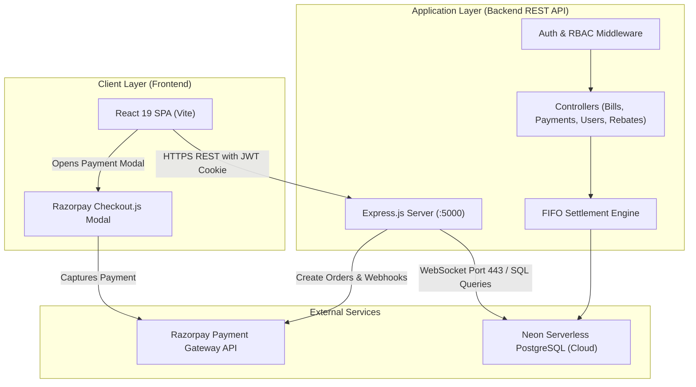
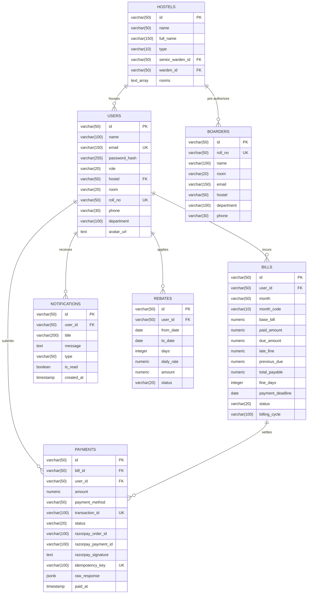

# MessLedger — System Architecture Document

**Architecture Version:** 1.0.0  
**Target Environment:** Node.js (v20+) • PostgreSQL (Neon Cloud) • React (Vite) • Razorpay Payments  

---

## 1. System Topology Overview

MessLedger operates on a modern decoupled Client-Server architecture with serverless cloud persistence and an integrated payment gateway.

---

## 2. Technology Stack

| Layer | Technology | Rationale & Selection Criteria |
| :--- | :--- | :--- |
| **Frontend Framework** | React 19 + Vite | Instant HMR, minimal footprint, modern declarative UI components. |
| **Styling & Design System** | Tailwind CSS (Zinc/Emerald Theme) | Curated modern aesthetic, dark/light theme switching, responsive utilities. |
| **Icons & Micro-animations** | Lucide React | High-clarity, consistent stroke icon system matching university aesthetic. |
| **Client Routing & State** | React Router DOM v7 + React Context | Role-based protected routes (`RoleProtectedRoute`), shared auth context. |
| **Backend Runtime** | Node.js (ES Modules) | High-concurrency asynchronous I/O, native crypto support for HMAC validation. |
| **API Framework** | Express.js | Robust middleware ecosystem (`cors`, `cookie-parser`, `express.json` with `rawBody`). |
| **Database & ORM** | PostgreSQL (Neon Cloud Serverless) | Relational integrity, ACID compliance, atomic transactions with row-level locks. |
| **Database Driver** | `@neondatabase/serverless` + `ws` | Connects over WebSocket port 443, eliminating ISP port 5432 firewall blocks. |
| **Payment Gateway** | Razorpay Node.js SDK + Checkout.js | Native Indian banking support (UPI QR, Intent, Cards, NetBanking), PCI-DSS compliance. |
| **Security & Auth** | JWT (`jsonwebtoken`), bcryptjs | Stateless, tamper-proof session cookies (`httpOnly`, `sameSite`, `secure`). |

---

## 3. Database Schema & Entity Relationship Diagram (ERD)

---

## 4. Key Architectural Flows

### 4.1. Razorpay Payment & FIFO Settlement Flow

```mermaid
sequenceDiagram
    autonumber
    actor Student as Student Boarder
    participant UI as Frontend (React)
    participant RzpSDK as Razorpay Checkout Modal
    participant API as Backend (Express)
    participant RzpAPI as Razorpay Gateway
    participant DB as PostgreSQL (Neon)
    actor Admin as Hostel Admin

    Student->>UI: Clicks "Pay Now" (Full or Partial)
    UI->>API: POST /api/payments/create-order { amount, billId }
    API->>RzpAPI: razorpay.orders.create({ amount_in_paise })
    RzpAPI-->>API: returns { id: order_id }
    API-->>UI: returns { orderId, amount, keyId }
    UI->>RzpSDK: new Razorpay(options).open()
    Student->>RzpSDK: Completes UPI/Card/NetBanking
    RzpSDK-->>UI: handler callback { razorpay_order_id, razorpay_payment_id, razorpay_signature }
    UI->>API: POST /api/payments/verify { signature, orderId, paymentId }
    
    rect rgb(20, 30, 20)
        Note over API,DB: Database Transaction (BEGIN ... COMMIT)
        API->>API: crypto.createHmac('sha256').verify(timingSafeEqual)
        API->>DB: Lock bills FOR UPDATE & Execute FIFO Settlement
        API->>DB: INSERT INTO payments (status: 'SUCCESS')
        API->>DB: INSERT INTO notifications (Student Confirmation)
        API->>DB: INSERT INTO notifications (Hostel Admin Alert)
    end

    API-->>UI: returns { success: true, verified: true, updatedBill }
    UI->>Student: Displays Success Voucher & Replaces "Pay Now" with "Fully Paid"
    API--)Admin: Admin Notification Bell updates unread counter
```

### 4.2. Webhook Asynchronous Reconciliation
- If a student closes the browser window after bank deduction before the frontend redirect completes:
  1. Razorpay issues a server-to-server webhook `POST /api/payments/webhook`.
  2. Express captures the raw payload via `express.json({ verify: (req, res, buf) => { req.rawBody = buf; } })`.
  3. Signature verified with `X-Razorpay-Signature` against `RAZORPAY_WEBHOOK_SECRET`.
  4. Triggers `settleStudentDues`, inserts payment record, and notifies student and hostel admin asynchronously.

### 4.3. Automated Late Fine Calculation Engine
- On bill retrieval (`getCurrentBill`, `getBills`, or `settleStudentDues`):
  1. Evaluates `today > payment_deadline`.
  2. If overdue: calculates `overdueDays = min(30, floor((today - deadline) / 86400000))`.
  3. Computes `lateFine = overdueDays * finePerDay (₹20)`.
  4. Automatically synchronizes `bills` table in PostgreSQL if the fine changed.

### 4.5. Administrative Room Reallocation Flow
- Student profile updates (`PUT /api/user/profile`) strip any `room` parameter, preventing boarder self-modification.
- Admin invokes `PUT /api/user/:id/room`:
  1. Validates `req.user.role IN ('ADMIN', 'WARDEN')`.
  2. Updates `users.room` for target student.
  3. Synchronizes master `boarders.room` for registration consistency.
  4. Dispatches in-app notification to the student: *"Hostel Room Reallocated: Your room has been updated to Room X by Hostel Administration."*

---

## 5. Security Architecture

1. **Authentication:**
   - JWT tokens generated with `HS256`, containing `{ id, email, role, hostel }`.
   - Stored in HTTP-only, SameSite cookies to protect against Cross-Site Scripting (XSS).
2. **Authorization Middleware:**
   - `authenticate`: Validates JWT token and extracts user context.
   - `requireAdmin`: Enforces `role === 'ADMIN' || role === 'WARDEN'`.
3. **Database Concurrency & Idempotency:**
   - Payment operations wrapped in `withTransaction` with PostgreSQL `FOR UPDATE` row locks.
   - Idempotency guard on `razorpay_payment_id` prevents duplicate ledger crediting.
