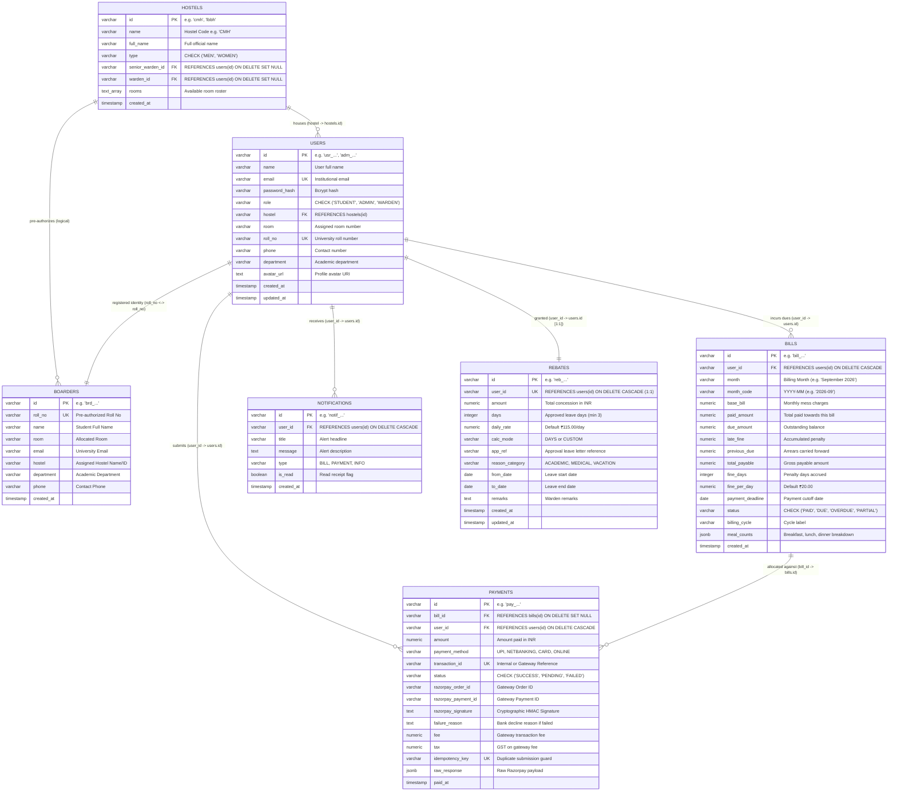

# MessLedger — Database Relationships & Relational Schema Architecture

**Database Engine:** PostgreSQL 16 (Neon Serverless Cloud)  
**Access Protocol:** WebSockets (Port 443) via `@neondatabase/serverless`  
**Schema Version:** 1.0.0  
**Last Updated:** October 2026  

---

## 1. Executive Summary

The **MessLedger** persistence tier is built on a highly normalized relational model designed for strict financial auditability, zero data redundancy, and automated multi-table cascading.

The database consists of **7 core tables**:
1. `hostels` — The foundational institutional entity defining all residential campus blocks.
2. `users` — The core identity table managing authentication and role-based permissions (`STUDENT`, `ADMIN`, `WARDEN`).
3. `boarders` — The pre-authorization master directory ensuring only valid university residents can register.
4. `bills` — Monthly billing cycles, itemized fees, cumulative arrears, and daily late fines.
5. `payments` — Transaction ledger tracking Razorpay orders, payments, webhooks, and FIFO dues settlement.
6. `notifications` — In-app notification center for payment confirmations, admin alerts, and defaulter notices.
7. `rebates` — Diet leave concessions directly offsetting students' active billing liabilities.

---

## 2. Entity-Relationship Diagram (ERD)



---

## 3. Relational Mapping Matrix

| Parent Table | Child Table | Foreign Key Column | Relationship Type | Delete Cascade Rule | Business Purpose |
| :--- | :--- | :--- | :---: | :---: | :--- |
| `hostels` | `users` | `users.hostel` | **1 : Many** | `ON DELETE SET NULL` | Associates students and admins with their residential/administered hostel. If a hostel is removed, user accounts are preserved. |
| `users` | `bills` | `bills.user_id` | **1 : Many** | `ON DELETE CASCADE` | Connects monthly mess bills to the resident boarder. Deleting a student wipes their bill history. |
| `users` | `payments` | `payments.user_id` | **1 : Many** | `ON DELETE CASCADE` | Links financial transaction records to the paying student for ledger auditing. |
| `bills` | `payments` | `payments.bill_id` | **1 : Many** | `ON DELETE SET NULL` | Links payment to the primary bill settled. If a bill cycle is archived, historical payment receipts remain intact for audit compliance. |
| `users` | `notifications`| `notifications.user_id` | **1 : Many** | `ON DELETE CASCADE` | Delivers in-app alerts (billing notices, payment receipts, reminders) to the user's notification center. |
| `users` | `rebates` | `rebates.user_id` | **1 : 1** | `ON DELETE CASCADE` | Restricts each student to one active diet rebate concession that offsets their active monthly mess bill. |
| `boarders` | `users` | *(Logical)* `roll_no` | **1 : 1** | *(Application Guard)* | Connects the institutional pre-registration roster to the active student account. |

---

## 4. Deep Dive: Table Relationships & Architectural Workflows

### 4.1. The Root Entity: `hostels`
- **Role:** Central catalog representing all university residential hostels (e.g. `CMH`, `LBBH`, `DWH`).
- **Outgoing Relationships:**
  - `hostels.id` ➔ `users.hostel` (**1:N**): Defines which hostel an administrator supervises or which hostel a student resides in.
- **Normalized Authority Foreign Keys:**
  - `hostels` links to `users` via `senior_warden_id` and `warden_id` foreign keys with `ON DELETE SET NULL`.
  - All contact information (name, phone, email) is stored exclusively in `users` to eliminate redundant data.
  - When querying hostel details, a simple `LEFT JOIN users` provides current contact information.
  - When an administrator or warden account is deleted, PostgreSQL automatically nullifies `senior_warden_id` or `warden_id` natively.

---

### 4.2. Identity & Access: `users`
- **Role:** Central identity store for authentication (JWT), RBAC roles (`STUDENT`, `ADMIN`, `WARDEN`), and institutional attributes.
- **Incoming Relationships:**
  - Inherits `hostel` from `hostels.id`.
- **Outgoing Relationships:**
  - One user owns **Many Bills** (`bills.user_id`).
  - One user owns **Many Payments** (`payments.user_id` — intentionally preserved for lifetime audit retention).
  - One user receives **Many Notifications** (`notifications.user_id`).
  - One user holds **At Most One Active Rebate** (`rebates.user_id` has a `UNIQUE` constraint).
- **Administrative Access Boundaries:**
  - `ADMIN` and `WARDEN` users do **not** have entries in `bills` or `rebates`. Their dashboard aggregates the bills of all students residing in their designated `hostel`.

---

### 4.3. Pre-Authorization & Verification: `boarders`
- **Role:** Institutional whitelist uploaded by university administration via CSV or manual entry before student registration.
- **Relationship to `users`:**
  - Connected via the unique institutional key `roll_no` (`boarders.roll_no = users.roll_no`).
  - When a student registers on `/register`, the system verifies `boarders` matching their roll number, email, and hostel.
  - Registration status is computed **dynamically** via `LEFT JOIN users` (`u.id IS NOT NULL`). Zero duplicate flags or synchronization drift.
- **Automatic Deletion Handling:**
  - When an admin deletes a student account (`DELETE /api/user/:id`), removing the row from `users` automatically causes `is_registered` to evaluate to `FALSE` in real time with zero extra update queries needed.

---

### 4.4. Monthly Financial Ledger: `bills`
- **Role:** Stores the monthly charges, meal counts, late penalties, and payment status for students.
- **Key Fields & Formula Invariants:**
  - `base_bill`: The monthly baseline dining charge.
  - `previous_due`: Arrears carried forward from prior unsettled months.
  - `late_fine`: Daily penalty assessed past `payment_deadline` (capped at 30 days = max ₹600.00).
  - `total_payable = base_bill + late_fine + previous_due`.
  - `due_amount = Math.max(0, total_payable - paid_amount - rebateConcession)`.
- **Status Lifecycle (`status`):**
  ```
     [New Bill Created]
            │
            ▼
        ┌───────┐
        │  DUE  │ ──(Deadline passed & due > 0)──► ┌─────────┐
        └───┬───┘                                  │ OVERDUE │
            │                                      └────┬────┘
            │                                           │
  (Partial Payment)                           (Partial Payment)
            │                                           │
            ▼                                           ▼
      ┌───────────┐                               ┌───────────┐
      │  PARTIAL  │ ◄─────────────────────────────┤  PARTIAL  │
      └─────┬─────┘                               └─────┬─────┘
            │                                           │
      (Due reaches 0)                             (Due reaches 0)
            ▼                                           ▼
        ┌───────┐                                   ┌───────┐
        │ PAID  │                                   │ PAID  │
        └───────┘                                   └───────┘
  ```

---

### 4.5. Transaction Ledger & Gateway Auditing: `payments`
- **Role:** Immutable financial journal documenting every gateway attempt, capture, and settlement.
- **Dual Relationship:**
  - Belongs to `users` (`user_id` ➔ `users.id`): Identifies the student payer.
  - Belongs to `bills` (`bill_id` ➔ `bills.id`): Identifies the primary bill cycle settled.
- **First-In, First-Out (FIFO) Cascade Settlement:**
  - A single transaction in `payments` can allocate funds across **multiple** rows in `bills`.
  - When a student pays ₹5,000 against a ₹2,000 prior due and a ₹3,000 current due:
    1. Bill Cycle 1 (`2026-08`) receives ₹2,000 ➔ status updates to `PAID`, `due_amount = 0`.
    2. Bill Cycle 2 (`2026-09`) receives remaining ₹3,000 ➔ status updates to `PAID`, `due_amount = 0`.
    3. `payments.bill_id` points to the latest cycle (`2026-09`), while the payment record preserves the full ₹5,000 credited.
- **Idempotency & Gateway Security:**
  - `idempotency_key UNIQUE`: Prevents network retries from double-crediting.
  - `razorpay_payment_id`: Verified against HMAC-SHA256 signature before database commitment.

---

### 4.6. Messaging & Alerts: `notifications`
- **Role:** Delivers real-time notifications to users' notification bells and centers.
- **Dual Recipient Trigger on Payment:**
  Whenever a record is committed to `payments`, the backend automatically resolves relationships to create **two** notification entries:
  1. **Student Notice (`user_id = paying_student.id`):**
     - *Title:* "Payment Successful"
     - *Message:* "Mess dues payment of ₹... verified and credited. Ref: ..."
  2. **Hostel Admin Notice (`user_id = admin.id`):**
     - Queries: `SELECT id FROM users WHERE role IN ('ADMIN', 'WARDEN') AND hostel = student.hostel`
     - *Title:* "Mess Dues Payment Received"
     - *Message:* "Payment of ₹... received from [Name] ([Roll No], Room [Room])."

---

### 4.7. Leave Concessions: `rebates`
- **Role:** Tracks warden-approved leave absence concessions (minimum 3 days @ ₹115.00/day).
- **1:1 Constraint (`user_id UNIQUE`):**
  - Enforces that each student has at most one active rebate concession per active billing period.
- **Financial Deduction Workflow:**
  - `rebates.amount = rebates.days * rebates.daily_rate (₹115.00)`.
  - When the student views their bill or pays dues, `settleStudentDues` and `getCurrentBill` deduct `rebates.amount` directly from the net due.

---

## 5. Foreign Key Cascades & Data Integrity Rules

```
+------------------------------------------------------------------------------------+
| PARENT DELETE ACTION               | CHILD IMPACT                                  |
+------------------------------------+-----------------------------------------------+
| DELETE FROM hostels WHERE id = 'x' | users.hostel -> SET NULL                      |
|                                    | (Admins and students remain in system)        |
+------------------------------------+-----------------------------------------------+
| DELETE FROM users WHERE id = 'u'   | hostels.senior_warden_id / warden_id ->       |
|                                    |   SET NULL (Native PostgreSQL FK cascade)     |
|                                    | bills -> CASCADE (All student bills deleted)  |
|                                    | payments -> CASCADE (Transactions deleted)    |
|                                    | notifications -> CASCADE (Alerts deleted)     |
|                                    | rebates -> CASCADE (Rebate deleted)           |
|                                    | boarders registration -> dynamically FALSE    |
+------------------------------------+-----------------------------------------------+
| DELETE FROM bills WHERE id = 'b'   | payments.bill_id -> SET NULL                  |
|                                    | (Payment journal preserved for bank audits)   |
+------------------------------------+-----------------------------------------------+
```

---

## 6. Performance Indexes

To support rapid lookups across large student bodies and high-concurrency payment gateway webhooks, the following indexes are maintained:

```sql
-- Gateway Lookups (Used by Webhooks and Verification Handlers)
CREATE INDEX idx_payments_rzp_order ON payments(razorpay_order_id);
CREATE INDEX idx_payments_rzp_payment ON payments(razorpay_payment_id);

-- User Payment Ledger Query (Used by Student Dashboard & Admin Audit)
CREATE INDEX idx_payments_user_status ON payments(user_id, status);

-- Unique Identity Constraints (Implicit B-Tree Indexes)
-- users(email) UNIQUE
-- users(roll_no) UNIQUE
-- boarders(roll_no) UNIQUE
-- payments(transaction_id) UNIQUE
-- payments(idempotency_key) UNIQUE
-- rebates(user_id) UNIQUE
```
